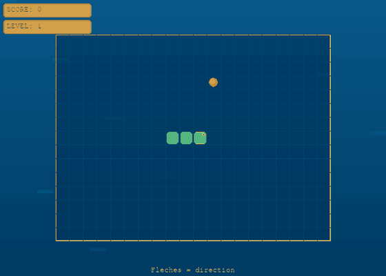
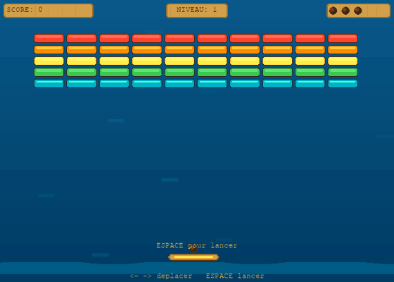

# L'Île des Mini-Jeux — my parts (Snake, Breakout, visual theme)

Two arcade mini-games and the shared visual theme that I wrote for **L'Île des Mini-Jeux**, a 2D exploration game in Python / Pygame built by a team of four at Polytech Grenoble (IESE, UE *Projet Logiciel*, May 2026).

This repository contains **only my parts**, with a small launcher so they can be played on their own. The full game (map, player, save system, Tetris, Pac-Man, Space Invaders, …) is the team's work and lives in the team repository: https://github.com/karim1232/projet_logiciel

## Demo
| Snake | Breakout |
|---|---|
|  |  |

*The GIFs are recordings of the real game code, played by a small autopilot script ([`tools/record_gifs.py`](tools/record_gifs.py)), not by a human.*

## What is here
- **Snake** — [`jeux/snake.py`](jeux/snake.py)
  - 20×15 grid; a new level every 5 apples, speed increasing each level down to a minimum interval.
  - Wall rings appear as levels increase (one extra ring every 5 levels).
  - Random star bonus (temporary double speed, bigger score); score multiplied by the current level.
  - Movement timing driven by `dt`, so the speed does not depend on the frame rate.
- **Breakout** *(added after the project report was written)* — [`jeux/breakout.py`](jeux/breakout.py)
  - Paddle and ball physics, generated brick grid (top rows take more hits), 3 lives, levels with increasing ball speed, particle effects on impacts.
- **Shared visual theme** — [`jeux/ete_theme.py`](jeux/ete_theme.py)
  - Common colour palette and drawing helpers: animated background, sine-wave lines, wooden UI panels, score HUD, game-over screen.
- **Launcher** — [`play.py`](play.py): a small standalone menu to try both games outside the full game.

Both games expose the same `update(dt)` / `draw(surface)` interface that the team's state machine expects, which is how they plug into the full game.

## Run
```bash
pip install -r requirements.txt
python play.py
```
`1` Snake · `2` Breakout · arrow keys to move · `Space` launches the Breakout ball · `R` restart · `Esc` back/quit.

## Credits
The full game was built by Karim Glelah, Mohamed Hashem, Tayeb Arroub and Nathan Carton. In the team's work split, Karim did Space Invaders, integration and saves; Tayeb Tetris and the game class architecture; Nathan Pac-Man and the Tiled maps. The 2D map, player movement and collisions were built together.
